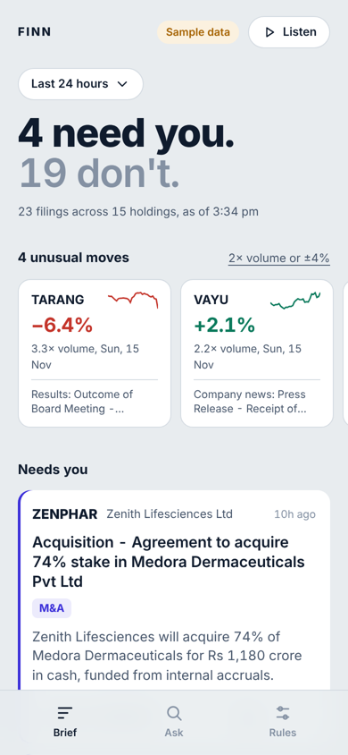
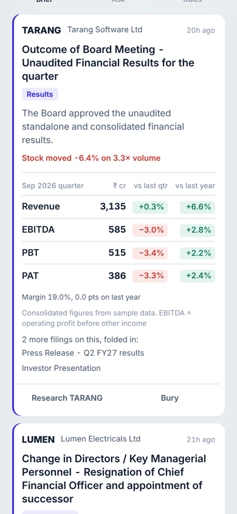
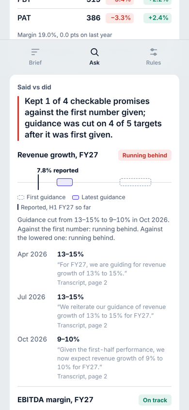
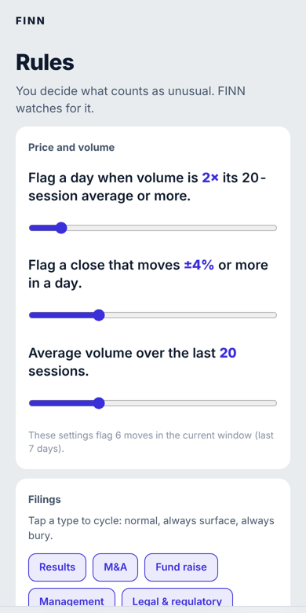

# FINN — Financial Investment Agent

A mobile-first agent for a daily investor. It does two things:

- **Push:** tells you what changed in your portfolio and why it matters, and buries the rest.
- **Pull:** researches any NSE ticker on demand from primary sources only.

<p>




</p>

## Run it

```bash
pip install -r requirements.txt

# 1. See the product in 10 seconds, offline, no keys (fictional companies, clearly marked)
FINN_DATA_MODE=sample python run.py        # open http://localhost:8000

# 2. Live data
cp .env.example .env                        # optionally add a model key
python scripts/smoke.py                     # checks every source from your machine
python run.py
```

On a phone: open the URL, then "Add to Home Screen". Deploy: `render.yaml` + `Dockerfile` are included
(Render free tier: New > Blueprint > this repo). Tests: `pytest -q`.

## The point of view

**Importance is ink.** The brief opens with one sentence — "4 need you. 19 don't." — and the page then
decays on purpose: full cards for what needs you, single lines for what is worth knowing, a grey count
for everything buried. Nothing is deleted; every routine filing is one tap away.

**A filing is not the event; the answer is.** A results filing shows Revenue / EBITDA / PBT / PAT with
QoQ and YoY on the card. A CFO change shows who is coming in and where from. Three filings about the
same thing on the same day are folded into one.

**Prices and filings explain each other.** A move that trips your threshold is shown with the filing
that most likely caused it; a filing that the market reacted to is ranked higher. A move with no filing
behind it says so — that is the one worth a second look.

**Summarising management is not analysing them.** "Said vs did" turns the last five concalls into a
ledger of numeric promises, then checks each against the reported numbers, including when guidance was
quietly cut and whether the company met the original number or only the lowered one.

**One box, three ways in.** Type or say a ticker (research), a question ("what did they say about
capex?"), a window ("last 7 days") or a rule ("alert me if volume is over 3x"). The brief can be read
aloud for the commute.

## What it does

| | |
|---|---|
| Windowed digest | 24h (default), 3d, 7d, 30d or exact dates. Three tiers: needs you, worth knowing, buried. |
| Triggered alerts | Volume ≥ N× its M-session average; close-to-close move ≥ ±X%. All three are sliders. Filing types can be set to always surface or always bury. In-app + browser notifications; optional Telegram push from a scheduled scan (`scripts/scan.py`, GitHub Actions cron included). |
| Results | First cut of the four headline numbers, QoQ and YoY, consolidated where available. |
| Management change | Name, role, action, and the incoming person's background from the filing's own "brief profile" (SEBI requires one), plus a LinkedIn search link. |
| Research (any NSE ticker) | Financial snapshot, said vs did, trajectory, balance sheet, cash quality, business, bull vs bear, grounded Q&A, sources. |
| Portfolio | 20 NSE names across sectors and sizes by default; editable in the app, stored on the device. |

## Architecture

```
web/            vanilla JS single-page app (no build step), PWA manifest + service worker
finn/app.py     stateless Flask API; the client owns portfolio + rules and sends them per request
finn/sources/   prices (Yahoo chart API), announcements (NSE → BSE → screener.in), screener (fundamentals
                + document links), documents (PDF → page text, cached by URL), sample (offline universe)
finn/classify.py  rules first; only filings the rules cannot place go to the cheap model, batched
finn/digest.py    score → tier → cluster → link moves to filings
finn/moves.py     threshold scan on EOD data
finn/enrich.py    results first cut, management-change profile, one-liners
finn/analytics.py deterministic financial cards and verdicts
finn/guidance.py  promise extraction (model or regex) + arithmetic evaluation
finn/research.py  staged research job, lexical page retrieval, grounded Q&A
finn/llm.py       two-tier router for any OpenAI-compatible endpoint, content-hash cache, usage ledger
finn/cache.py     SQLite KV with TTL and stale-on-error
```

### Cost and model routing

The design goal is that a model is the last resort, not the default.

1. **No model at all** for: classification of formulaic filings, scoring, alerts, every number and
   every financial verdict, retrieval (TF-IDF over pages, no embeddings), and command routing.
2. **Cheap model** for bulk, structured work: ambiguous filings (titles only, 25 per call), guidance
   extraction per transcript (only pages containing guidance language are sent), management profiles,
   the business snapshot (six retrieved annual-report pages, not the whole report).
3. **Strong model, one call per company:** the analyst read and bull/bear, written from a compact fact
   sheet that code computed — never from raw documents.
4. **Cache everything immutable.** Filings and transcripts never change, so PDFs, page text, extractions
   and model outputs are cached by content hash. A second look at a company costs zero tokens. The
   Rules screen shows calls, cache hits and tokens per tier.

With no key configured the app still works end to end: regex guidance extraction, rule-written verdicts
and extractive Q&A take over, and the UI says which path produced what.

### Honesty rules built into the product

- A model never computes or judges a number. It extracts what was said; code compares it with what was reported.
- Pull uses the company's statements, transcripts and annual report only. Prompts forbid outside knowledge and require page references.
- Every source call falls back to the last good answer and is flagged as stale; failures are reported in the brief, not hidden.
- Scanned PDFs with no text layer are listed as skipped rather than guessed at.

## Verification

- `pytest -q`: 36 tests — parsers for each upstream format (the screener fixture carries Reliance's
  real consolidated figures), classifier cases, alert thresholds, said-vs-did arithmetic, the model
  router against a local OpenAI-compatible stub (routing, JSON repair, caching), and the API end to end.
- `python scripts/smoke.py [TICKER]`: one live request to each upstream, with a plain PASS/FAIL. Run it
  on your laptop and on your host — NSE in particular treats datacentre IPs differently, which is why
  filings have three sources in a fallback chain.

## Deliberately left out

Accounts and server-side state; intraday data; OCR for scanned filings; embeddings/vector DB;
capex and non-headline guidance grading (shown, marked "not checkable"); position sizes and P&L.

## Next

Cross-check filing-parsed results against the standardised tables; OCR fallback; web-push with VAPID so
alerts arrive with the app closed; segment-level said-vs-did; peer-relative context on every card;
learning from what the user buries.
